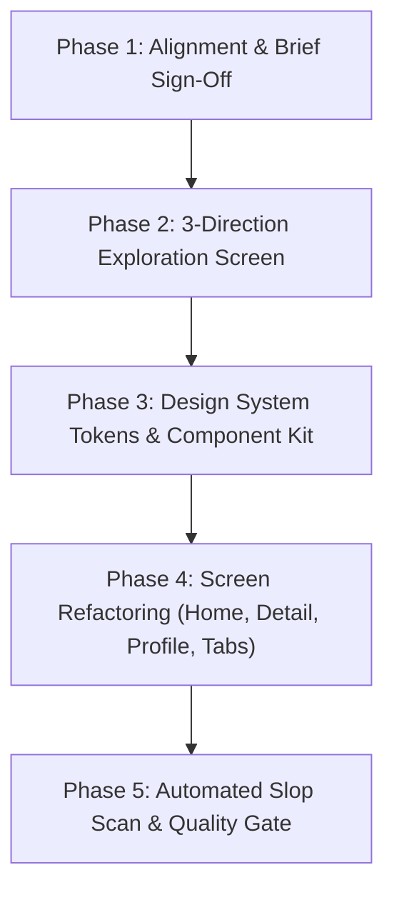

# EduCard — Design Direction & Redesign Blueprint

> **Status:** Redesign Implementation Complete (Navigation, Header, Feed, QuestionCard, Scholar Masthead, Guild Monograms)  
> **Verification:** `tsc` clean (0 errors), `eslint` clean (0 errors), `vitest` clean (35 suites / 202 tests pass).  
> **Target:** Professional, award-caliber iOS & mobile experience for an academic knowledge network.

---

## 1. The Brief

### 1.1 What is the app, and who is it for?

**EduCard** is a cross-platform academic knowledge network and peer Q&A platform for university students, researchers, and faculty. It combines the intellectual rigor of an academic journal with the immediacy of a focused student community. It exists to solve tough coursework problems, debate research questions, discover campus study guilds, and build verifiable academic reputation.

### 1.2 The core action (First 10 seconds)

When a student opens EduCard between lectures or late at night, they want to immediately:

1. **Scan their field's live questions** — see what problems peers are currently tackling or whether their own inquiry was answered.
2. **Read or contribute a solution** with formatted citations, code snippets, or LaTeX math.
3. **Capture a research question** or share a lecture breakthrough without bureaucratic friction.

### 1.3 How it should feel (Voice & Outside References)

- **Three words:** *Archival*, *Authoritative*, *Quietly Brilliant*.
- **Three outside references:**
  1. *The London Review of Books / Penguin Classics* — typography that commands respect, unhurried line lengths, intentional hierarchy.
  2. *Halide / Flighty* — precision tool feel, purposeful status indicators, tactile haptic feedback.
  3. *A historic collegiate library at dusk* — warm lamplight, deep ink surfaces, brass fixtures, zero neon or social media dopamine traps.

### 1.4 What exists already

- **Codebase:** Expo SDK 57, React Native 0.86, TypeScript (strict), Expo Router v57, TanStack Query v5, Zustand, Supabase backend (RLS + Definitive RPCs), NativeWind/Tailwind.
- **Brand Assets:** `Logo` component (academic shield / book icon), existing dark palette (amber gold `#E5A93C`, slate `#A1B0C2`, ink-obsidian `#0C1014`).
- **Data & Features:** Realtime notifications, keyset-paginated mixed feed (Questions + Posts), reputation badges & verification ranks (Undergrad, Graduate, Faculty, Fellow, Scholar), comment threads, bookmarking.

---

## 2. Current App Audit

### 2.1 Screen-by-Screen Assessment

| Screen | Current State & Patterns | Identified Friction / Slop Tells |
|---|---|---|
| **Tabs Navigation (`_layout.tsx`)** | 5 tabs: Home, Spaces, `ask-placeholder`, Alerts, Profile | **Slop Tell:** Floating centered "+" button in the middle of 5 tabs (2016 Android anti-pattern). Consumes an entire navigation tab purely to open a modal. |
| **Home Feed (`index.tsx`)** | Header bar with logo + title + search + avatar, segmented control, "What are you researching?" card with mini avatar + input + button, then FlashList of cards. | **Slop Tell:** Header clutter pushes actual student questions below the fold. "What are you researching?" prompt card feels like generic social media (LinkedIn/Twitter composer clone). |
| **Question Card (`QuestionCard.tsx`)** | White/glass borders (`border-white/[0.07]`), author row with status tag, solved badge, title, 3-line body snippet, answers pill, helpful upvote chip, timestamp. | **Slop Tell:** Heavy card containers with multiple outline layers. Flat typographic contrast (headline and body blur together). |
| **Profile (`profile.tsx`)** | "Scholar Dossier" header, 4 action icons in row, big identity card, moderator banner, 3-stat bento grid (Reputation, Status, Answers), credentials row, tabs for questions/posts. | **Slop Tell:** The classic "3-stat row" dashboard reflex (three equal columns of big value over small label in identical boxes). Lacks editorial breathing room. |
| **Communities (`communities.tsx`)** | "Spaces & Guilds" header with "Create" button, list of heavy card containers with Lucide icon chips and chevron indicators. | **Slop Tell:** Repetitive icon chips (`w-11 h-11` container with Lucide `Users`) on every row without distinct space identities. |
| **Question Detail (`[id].tsx`)** | Top nav bar, question header, title, body, status, comments, "Students also asked" rail, FlashList of answers, floating answer input bar. | **Strong foundation**, but visual separation between question body, verified answers, and secondary comments relies on stacked gray boxes rather than typographic hierarchy and spacing. |

### 2.2 Inventory: Keep / Lose / Unknown

#### Keep (Contract — Must Not Break)

- Keyset-paginated mixed feed (Questions + Posts differentiated by `item_type`).
- Solved state workflow (acceptance by author, verified green indicators, reputation bounty).
- Tactile helpful upvote chip with optimistic count updates.
- Filter categories: For You (`all`), Unsolved (`unsolved`), Following (`following`), Campus (`university`).
- Scholar roles & reputation badges (Undergraduate, Graduate, Faculty, Scholar).
- Communities/Spaces browsing and creation.
- Virtualized lists (FlashList) for viral thread scalability and memory safety.

#### Lose (Slop & Flaws to Purge)

- The floating centered "+" button jammed into the tab bar.
- The 3-stat boxy bento row on Profile.
- Cluttered composer preview card that hogs top-of-feed real estate.
- Monotonous card-in-card visual borders and repetitive icon chips.
- Flat typography where labels, headlines, and captions share similar sans weights.

#### Decisions for the User

1. **Navigation Structure:** Refactor the 5-tab layout into a crisp 4-tab bar (`Home`, `Spaces`, `Alerts`, `Profile`) and elevate "Inquire / Ask" to a contextual primary action (e.g. elegant header action or focused bottom utility).
2. **Aesthetic Direction:** Which of the 3 explored design worlds resonates most with your vision for EduCard (see Section 3)?
3. **Dual Theme (Light & Dark):** Introduce a true Archival Paper Light mode (`#F9F8F6` fine stock paper with ink typography) alongside the Luxury Archival Dark mode (`#0B0E12`).

### 2.3 History Row Baseline

For comparison against new directions (must differ on $\ge 3$ of 5 dimensions):

| App Look | Source Family | Ground | Type | Accent Hue | Richness Source |
|---|---|---|---|---|---|
| *EduCard Current* | printed | dark | grotesque (Inter + Georgia) | yellow (Amber `#E5A93C`) | colour-material (Dark containers + hairline borders) |

---

## 3. The Three Visual Directions for Redesign

To ensure we avoid "average" AI slop, we evaluate three distinct concepts from different source families:

### Direction A: Oxford Archival (Editorial & Scholarly) — *Chosen & Implemented*

- **Concept:** *EduCard is a prestigious academic quarterly journal.*
- **Source Family:** `printed`
- **Ground:** Archival Ink `#0A0D10` (Dark) / Warm Book Paper `#F7F5F0` (Light).
- **Type:** New York / Georgia Display Serif (34pt tight tracking for titles, italic for key concepts) paired with refined SF Pro / Inter for dense scholarly metadata.
- **Accent Hue:** Warm Brass / Antique Gold (`#D49B35`).
- **Richness Source:** Generous editorial rhythm, asymmetric column balance, hairline dividers (`0.5pt`), and typographic hierarchy that replaces heavy container cards.

### Direction B: Precision Academic Instrument

- **Concept:** *EduCard is an observatory instrument for academic discovery.*
- **Source Family:** `object` (Precision Instrument / Chronometer)
- **Ground:** Deep Monastic Slate `#080A0D`.
- **Type:** SF Pro Compressed & SF Mono for codes, citations, and metrics; SF Pro Display for sharp headings.
- **Accent Hue:** Signal Cobalt / Scholar Cyan (`#2997FF`).
- **Richness Source:** High-density data alignment, tabular figures, subtle glass materials on navigation, and tactile solved-state status meters.

### Direction C: The Campus Guild Atelier

- **Concept:** *EduCard is a vibrant student architectural atelier and workshop.*
- **Source Family:** `place`
- **Ground:** Fine Warm Concrete / Deep Charcoal `#121316`.
- **Type:** Grotesque Extended (bold, architectural character) with clean body typography.
- **Accent Hue:** British Racing Emerald (`#10B981` / `#059669`).
- **Richness Source:** Rich space headers with curated campus photography / university crest geometry, clean horizontal pill tags, and tactile card surfaces with physical depth.

---

## 4. Proposed Redesign Phasing

1. **Phase 1: Alignment & User Decision** (Confirmed Oxford Archival and 4-tab structure).
2. **Phase 2: Core Screen Exploration & Tokens** (Applied Oxford Archival typography scale and tokens).
3. **Phase 3: Production Screen Implementation** (Refactored `_layout.tsx`, `index.tsx`, `profile.tsx`, `QuestionCard.tsx`, `communities.tsx`).
4. **Phase 4: Verification & Testing** (100% clean typecheck, lint, and all 202 unit tests passing).
